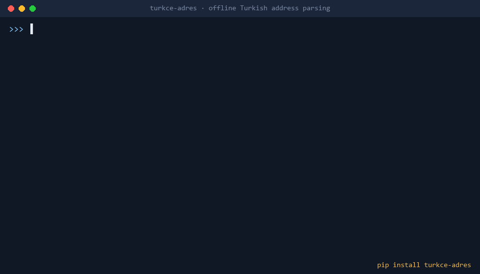

# turkce-adres

[Türkçe](README.md)

[](https://pypi.org/project/turkce-adres/) [](LICENSE-DATA.md)



An offline, dependency-free Python library and command line tool for Turkish addresses:

- **Parse** free-text addresses into province, district, neighbourhood/village, street (street, avenue, boulevard, dead end, square), house number, block, floor, unit, building, postcode, and landmark phrases such as "Migros karşısı" (opposite Migros).
- **Fix** all-caps ASCII spelling (`CAFERAGA` → `Caferağa`, `BUYUKDERE` → `Büyükdere`) and typos in province and district names (`Istnbul` → `İstanbul`); format to a standard (cargo) or official style.
- **Validate** the neighbourhood against a list of 66,687 neighbourhoods, villages and quarters; infer a missing district or province from the neighbourhood or postcode.
- **Geocode offline:** approximate coordinates at street, neighbourhood, district or province level. No request leaves your machine.
- **Match** two addresses ("same place?") and group duplicates in a CSV file.
- **Generalise for privacy (KVKK/GDPR):** drop house number, unit and postcode and keep only neighbourhood, district or province before sharing data.
- **Delivery check:** list what is missing or inconsistent (no house number, district not in this province...).
- **Two languages:** field names, notes and CLI messages in English or Turkish.

```bash
pip install turkce-adres
```

## Usage

```python
from turkce_adres import parse, format_address, geocode, similarity, generalise, missing

a = parse("ISTANBUL BESIKTAS LEVENT MAH. BUYUKDERE CAD NO 185 D 4")
a["province"], a["district"], a["neighbourhood"], a["street"], a["number"], a["unit"]
# ('İstanbul', 'Beşiktaş', 'Levent', 'Büyükdere', '185', '4')

format_address(a)            # 'Levent Mah. Büyükdere Cad. No:185 D:4, Beşiktaş/İstanbul'
geocode(a, "en")             # {'lat': ..., 'lon': ..., 'level': 'street', 'source': 'OpenStreetMap (ODbL)'}
similarity("CAFERAGA MH MODA CD NO 12 KADIKOY ISTANBUL",
           "Caferağa Mahallesi, Moda Caddesi No:12, Kadıköy/İstanbul")       # 1.0
generalise("Caferağa Mah. Moda Cad. No:12 D:3 Kadıköy/İstanbul 34710", dil="en")["text"]
# 'Caferağa Mah., Kadıköy/İstanbul'
missing("Moda Cad. Kadıköy", dil="en")
# ['neighbourhood or village missing', 'house number missing', 'postcode missing (recommended)']
```

Every result also carries `confidence` (0-1) and `notes` (what was corrected or inferred). Pass `fix=False` to keep words as written. Turkish field names: `from turkce_adres import ayristir`.

### Command line

```bash
turkce-adres "kızılay meydanı ziya gökalp cd 12 çankaya ankara" --lang en --format --geocode
turkce-adres customers.csv --column address --lang en --format --geocode --missing --dedupe -o out.csv
turkce-adres customers.csv --column address --lang en --generalise mahalle -o shareable.csv
```

If your file already has a column with the same name as a new field, nothing is overwritten: new columns get the `adres_` prefix.

## Evaluation

Comparison ignores case and Turkish diacritics. "All fields correct" is the share of addresses where every labelled field is right.

| Set | How it was made | All fields correct |
|---|---|---|
| `bench/sinama.jsonl` (6,000) | Turkish OpenStreetMap addresses rendered with templates; never looked at during development | **99.5% (5,969 / 6,000)** |
| `bench/gelistirme.jsonl` (6,000) | Same method; rules were tuned on this set | 99.5% (5,973 / 6,000) |
| `bench/zor.tsv` (58) | Hand-written, hand-labelled messy addresses (labelled fields, typos, district without province, site/block, villages, dead ends, landmarks) | 100% (58 / 58), see the note below |

**Limits:**

- The first two sets are template-generated. The third was written by the author of this project and some rules were fixed after looking at it, so it is not an independent benchmark. Real-world input will score lower.
- Neighbourhood validation, geocoding and spelling fixes only know what OpenStreetMap knows. Street-level coordinates exist only for streets with addresses in OSM (14,777 streets). Coordinates are **approximate**: OSM centre points for neighbourhoods and villages, medians of those for districts and provinces.
- The postcode-to-district table is derived only from OSM address tags (792 postcodes); the PTT list is not used.
- `generalise` is generalisation, not anonymisation on its own.
- No validation against the official national address registry (UAVT), which is not public.

## About the name

This project was first opened on GitHub as `tr-adres`. The `tr-adres` package on PyPI is an independent project by another developer; to avoid confusion this package is published as `turkce-adres` (module `turkce_adres`, command `turkce-adres`).

## License

- Code: [MIT](LICENSE).
- The gazetteers in `src/turkce_adres/veri/` and the test sets in `bench/*.jsonl` are derived from OpenStreetMap data, **© OpenStreetMap contributors**, [ODbL 1.0](LICENSE-DATA.md).
